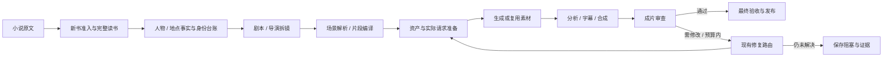

# 产线全景图（2026-10-09）

这是当前代码的流程入口。具体职责见[架构](architecture.md)，生产经验与真实成片结论见[生产经验](production-lessons.md)。本页不代表当前任务正在运行，资源数量以配置和运行状态为准。

## 从原文到交付

1. **新书接入**：`scripts/setup_book_thin.py` → `application/planning/setup_book.py`。
   切章建工作区、逐章读书、沙箱归并、设计初始人物库，再核对台账名单。
   单独 build_bible 是低层初始化步骤，不代替完整读书；已有书沿用注册集号与原文偏移。
2. **身份与资产资料**：reading_cast、story_bible、entity、别名与阶段记录保留各自已有用途。
   读书事实与外貌设计分开；身份减账的目标和实施边界见[记录](identity-convergence-20261008.md)。
3. **规划与编译**：application 读取章节资料并调用既有模型；planning 提供请求和检查，
   story 共用动作、身份、对白和场景规则。打包保留来源、片段编号和拆分关联。
4. **开拍准备**：准备所需人物/场景/穿戴卡，检查实际英文请求及其参考素材。
   输入问题沿原准备失败交接，不能因“资产文件存在”就认为素材正确。
5. **生成与后期**：application/rendering 串联缓存、提交、分析、合成和报告；
   media 提供独立能力，providers 承担现有 SD/H3 协议。无对白仍检查意外语音。
6. **审查、修复和发布**：按实际成片、当前请求和历史决定保留旧片、改输入或重拍。
   预算、计费、缓存和原有人工放行保持；素材齐全不等于内容或整集验收通过。

## 两种执行方式共用调度

| 执行方式 | 谁推进单集 | 共用能力与限制 |
|---|---|---|
| standard | 既有规划、准备、渲染及审修流程 | Conductor、文件记录、模型槽、生成池、锁、暂停和预算 |
| episode_agent | 每集持续沙箱会话，自主调用宿主工具；工具完成后续接原会话 | 同一调度与宿主能力；当前只支持H3，已有读书/剧本/资产可直接接入 |

Agent 的生命周期、启动接续、一次模型回合、草稿、媒体、修复、证据和收尾有独立所有者。
它与恢复、缓存、Phanthy的已验证实现均已合入 main；旧工作树或运行快照不自动更新。
模型请求槽在宿主工具运行时释放，生成继续使用公共池，不因为多开Agent就增加实例能力。

## 操作范围

`scripts/pipeline.py` 统一管理 production、prepare、repair，默认只在用户执行start时启动。
status只读取保存状态。看板和命令行消费相同的生产状态；工作台读取普通书、分集和嵌套Agent书。

- 只规划：`thin_batch.py --stage plan`。
- 只生成：`thin_batch.py --stage render`；默认不追加内容审修。
- 只审查：`thin_batch.py --review-only` 或 `thin_review.py episode`。
- 自动审修：既有 `--unattended`、`render_clips_thin.py --review/--repair`；共用单集执行器。
- 缓存合成：`--cache-only` 不提交生成、重建资产或清空历史。

完整参数和初始化示例见[README](../README.md)，Agent输入模式见[Agent说明](episode-agent.md)。

## 资源与状态从哪里看

- 小说范围、执行器和资源分配：`configs/pipeline.json`。
- 画幅、画风及小说级质检口径：小说的 `profile.json`；本集有效配置由resolved_settings解析。
- 端点与凭据：环境及项目.env；文档不保存凭据值。
- 进程、在途、待处理与阻塞：pipeline status和看板；GPU利用率与可交付净增分开看。
- 产物和修复历史：原章节目录；普通章和分集由公共episodes规则识别，不丢掉分集后缀。
- 运维探针：已经合入main的episode工具doctor；探活通过不等于生成或内容验收通过。

## 维护与验证

31个thin命令只负责启动；原文读取位于source，基础渲染和技术质检位于media，人物库构建位于application/planning。
旧API和兼容导入不恢复；历史小说、素材、计数、任务和其他会话草稿不随结构整理移动。
固定15项结构整理的实施与验证见[固定清单](structure-debt-20261008.md)，跨层回归见[测试说明](../tests/README.md)。
模型请求和供应商在测试中模拟，媒体验证使用固定短素材与真实FFmpeg；离线通过不代表新增成片已通过。
多会话所有权和实际在途任务见[工作板](active-sessions.md)；代码已合并不代表后台任务已收工。
